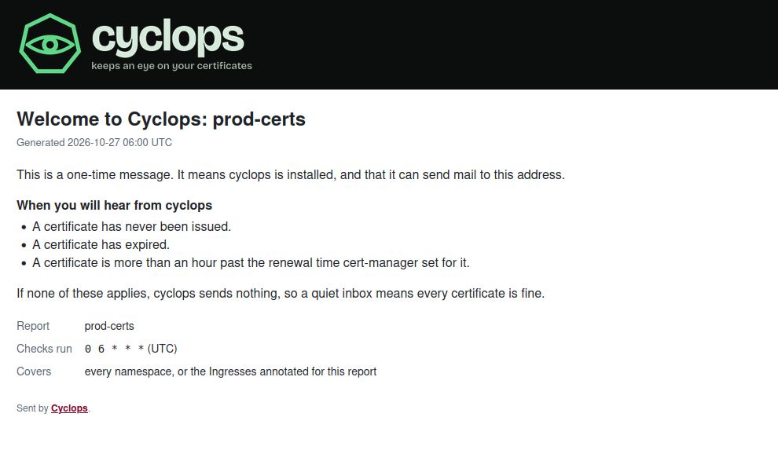
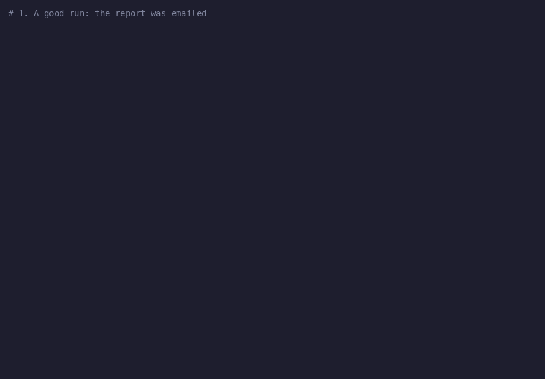
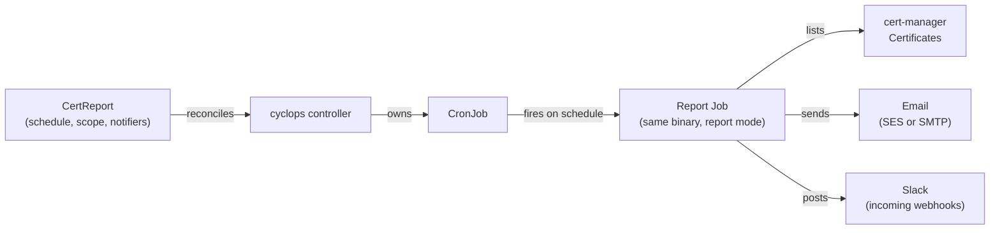

<h1 align="center"></h1>
<p align="center"><sub>The one-time welcome email, rendered from the built-in template with sample data.</sub></p>

<p align="center">
  <a href="https://github.com/sakshitposting-irl/cyclops/releases"></a>
  <a href="LICENSE"></a>
</p>

**cert-manager renews your certificates automatically, until it silently doesn't.** An ACME
challenge starts failing, an issuer loses its CA Secret, a renewal stalls, and nobody finds out
until the site is down. cyclops is the backstop: a Kubernetes controller that emails you or posts to
Slack when a certificate is **expired, never issued, or overdue for renewal**, and includes
cert-manager's own failure reason so you can see why.

A healthy cluster stays quiet. cyclops only sends a report when something needs attention.

## Why cyclops

- **No Prometheus needed.** It reads cert-manager `Certificate` resources directly. If you already
  alert on cert-manager metrics, cyclops is a second line of defence that also tells you *why*.
- **It explains the failure.** Reports include failed attempts, ACME state, and the failure reason
  word for word. For CA, Vault and self-signed issuers it shows the request's `Ready` reason and
  the issuer's error ([ADR 0021](docs/decisions/0021-issuer-diagnostics.md)).
- **It tells you when it breaks.** A failed report run shows up as `ReportSucceeding=False` on the
  `CertReport`, plus a Warning Event ([ADR 0019](docs/decisions/0019-failed-run-visibility.md)).
- **Least privilege.** The controller never reads certificates and the report Pod has read-only
  access. They use separate ServiceAccounts.
- **Email or Slack.** SMTP, SES or Slack incoming webhooks (Slack from `v0.1.0-beta.8`).

## Quick start

```sh
kubectl create namespace cyclops-system

helm install cyclops oci://ghcr.io/sakshitposting-irl/charts/cyclops --version 0.1.0-beta.8 \
  --namespace cyclops-system \
  --set email.smtp.host=smtp.example.com

kubectl apply -f - <<'YAML'
apiVersion: cyclops.sakshitposting-irl.github.io/v1alpha1
kind: CertReport
metadata: {name: cluster-certs}
spec:
  schedule: "0 8 * * *"             # UTC
  notifiers:
    - type: Email
      email: {from: cyclops@example.com, to: [platform@example.com]}
YAML
```

Needs a cluster with [cert-manager](https://cert-manager.io) and Helm 3.8+. SMTP logins, SES, Slack
and every option are in [Install the beta](#install-the-beta). To try it with no real mail server,
see [Try it on kind](#try-it-on-kind).

> [!NOTE]
> **Status: beta, in development.** The API is still `v1alpha1` and can change between releases.
> **Tested:** the full path on kind with a fake mail server and a fake Slack, and SMTP against Gmail
> (STARTTLS on 587, TLS on 465). **Not yet run:** SES against real AWS, and real Slack, so Slack's
> message limits are untested. Try it on a non-production cluster first. Details in [Status](#status).

## Install the beta

> [!WARNING]
> `v0.1.0-beta.8` is a beta. Use `beta.6` or newer: `beta.5`
> crash-loops on startup.
> Real SMTP authentication and STARTTLS have run against Gmail; SES has not been run against real AWS (only against a fake client). Try it on a non-production cluster first,
> or on kind with [the section below](#try-it-on-kind).

**Prerequisites:** a cluster with [cert-manager](https://cert-manager.io) installed, `kubectl`, and
[Helm](https://helm.sh) 3.8 or newer (needed for OCI charts).

The chart is published at `oci://ghcr.io/sakshitposting-irl/charts/cyclops` and the image, for
linux/amd64 and linux/arm64, at `ghcr.io/sakshitposting-irl/cyclops`. The chart's `appVersion` is
the image tag, so a chart version installs the matching image.

**1. Create the namespace, and the mail credentials only if you need them.** If your SMTP server
wants a login (or SES should use static keys), create the Secret yourself. Credentials never go
through chart values ([ADR 0014](docs/decisions/0014-notifier-credentials.md)):

```sh
kubectl create namespace cyclops-system

kubectl -n cyclops-system create secret generic cyclops-mail-credentials \
  --from-literal=username=<user> --from-literal=password=<password>      # SES: access-key-id, secret-access-key
```

**2. Install the chart.** Mail delivery is configured once per install, in the chart values. A
`CertReport` only says who gets the email:

```sh
helm install cyclops oci://ghcr.io/sakshitposting-irl/charts/cyclops --version 0.1.0-beta.8 \
  --namespace cyclops-system \
  --set email.smtp.host=smtp.example.com \
  --set email.smtp.credentialsSecretName=cyclops-mail-credentials   # leave out if no login is needed
```

SMTP uses STARTTLS on port 587 by default; see `email.smtp.tls` and `email.smtp.port`. For an
unauthenticated relay use `--set email.smtp.tls=None` and no credentials Secret (the chart rejects
`None` together with one). For SES, set `email.provider=SES` and `email.ses.region`, and give the
report ServiceAccount an AWS identity, for example an IRSA annotation through
`reportServiceAccount.annotations`, or name a Secret in `email.ses.credentialsSecretName`.

From `beta.8`, email is optional: with neither
`email.smtp.host` nor `email.ses.region` set, the chart installs no mail settings, for an install
that only posts to webhooks, such as [Slack](#slack). A `CertReport` with an Email notifier then fails its runs with
a message saying email is not configured.

This creates the `CertReport` CRD, both ServiceAccounts with their RBAC, the mail ConfigMap and the
controller Deployment. Every value, and how to customise the email template, is in the
[chart README](charts/cyclops/README.md). Check that the controller is running:

```sh
kubectl -n cyclops-system get pods
```

**3. Create a `CertReport`.**

```sh
kubectl apply -f - <<'EOF'
apiVersion: cyclops.sakshitposting-irl.github.io/v1alpha1
kind: CertReport
metadata: {name: cluster-certs}
spec:
  schedule: "0 8 * * *"             # UTC; this is the default
  namespaces: []                    # empty means every namespace
  notifiers:
    - type: Email
      email: {from: cyclops@example.com, to: [platform@example.com]}
EOF
```

**4. Check it.**

```sh
kubectl get certreport,cronjob -A
kubectl get certreport cluster-certs -o jsonpath='{range .status.conditions[*]}{.type}={.status} ({.reason}){"\n"}{end}'
```

`ScheduleValid`, `NamespacesFound`, `CredentialsFound` and `TemplateValid` should all be `True`.
`ReportSucceeding` is `Unknown` (`NoRunsYet`) until the first scheduled run. To send a report now
instead of waiting for 08:00, run the CronJob once and read its logs:

```sh
kubectl -n cyclops-system create job --from=cronjob/cyclops-cluster-certs first-run
kubectl -n cyclops-system logs job/first-run
```

A healthy cluster logs "nothing to report" and sends no email. That is by design.

**Without Helm.** The kustomize manifests in `config/` still work: follow
[Deploying your own build](#deploying-your-own-build), using the published image
(`ghcr.io/sakshitposting-irl/cyclops:v0.1.0-beta.8`) instead of building one. Whether they stay a
second supported install path is not decided ([ADR 0016](docs/decisions/0016-packaging.md)).

### When a report run fails

A healthy day sends no email, so a broken report run would be silent too. To avoid that, the
controller reads the owned CronJob's status and sets `ReportSucceeding` on the `CertReport`:
`True` when the latest scheduled run succeeded, `False` (reason `LastRunFailed`, plus one Warning
Event) when it failed, and `Unknown` while there has been no run yet or the CronJob is suspended.
While a run is in progress the previous value is kept.



The recording is a real run on kind (`hack/demo/failed-run.sh`). The condition only says that a run
failed. For the cause, read the Job's logs:

```sh
kubectl get certreport cluster-certs -o jsonpath='{.status.conditions[?(@.type=="ReportSucceeding")].message}'
kubectl -n cyclops-system logs job/<failed-job>
```

This is a plain status condition, so it works without Prometheus or any other monitoring stack.
If you do run one, you can alert on the condition yourself; cyclops ships no alert rules.

Only scheduled runs count. A Job you create by hand with `kubectl create job --from=cronjob/...`
does not change `ReportSucceeding`.

**Uninstall.** Delete the reports first, so Kubernetes removes the CronJobs they own, then the
release:

```sh
kubectl delete certreport --all
helm uninstall cyclops -n cyclops-system
```

The chart keeps the CRD when it is uninstalled (`crd.keep`, default `true`), so any `CertReport` you
did not delete survives. To remove everything, including the credentials Secret you created:

```sh
kubectl delete crd certreports.cyclops.sakshitposting-irl.github.io
kubectl delete namespace cyclops-system
```

### Ingress annotation mode

Set `spec.ingressAnnotationMode: true` (exclusive with `spec.namespaces`) and annotate each Ingress
you want in that report with `cyclops.sakshitposting-irl.github.io/cr-name: <CertReport name>`. The
Certificates behind its `tls[].secretName` entries are reported.

```yaml
apiVersion: cyclops.sakshitposting-irl.github.io/v1alpha1
kind: CertReport
metadata: {name: prod-certs}
spec:
  ingressAnnotationMode: true       # cannot be combined with namespaces
  notifiers:
    - type: Email
      email: {from: cyclops@example.com, to: [platform@example.com]}
---
apiVersion: networking.k8s.io/v1
kind: Ingress
metadata:
  name: shop
  namespace: tenant
  annotations:
    cyclops.sakshitposting-irl.github.io/cr-name: prod-certs
spec:
  tls: [{hosts: [shop.example.com], secretName: shop-tls}]   # the Certificate with this secretName is reported
```

Each row in the report names the Ingress it came from. Report Pods need to read Ingresses; the
Helm chart grants this unless you set `rbac.ingressAccess: false`.

An annotation that names a CertReport that does not exist, or has a typo in the key or the name, fails
silently: the Ingress is just never reported and nothing is logged; checking the annotation is up to the
Ingress owner. Anyone who can edit an Ingress can send that Ingress's certificate details to a
CertReport's recipients, so restrict who can edit Ingresses.

### Slack

> [!NOTE]
> New in `v0.1.0-beta.8` (`beta.7` rejects `type: Slack`). It has been tested with envtest and on
> kind against a fake Slack, not yet against real Slack.

A Slack notifier posts the report to one or more
[incoming webhooks](https://api.slack.com/messaging/webhooks). A webhook URL is itself a credential
(anyone with it can post), so it never goes in the `CertReport`: each target names a Secret in
`cyclops-system` that holds the URL under the key `url`.

```sh
kubectl -n cyclops-system create secret generic slack-oncall \
  --from-literal=url=https://hooks.slack.com/services/T000/B000/XXXX
```

```yaml
notifiers:
  - type: Slack
    slack:
      targets:
        - name: oncall                        # lowercase letters, digits and "-"; unique per CertReport
          urlSecretRef: {name: slack-oncall}
        - name: platform-certs
          urlSecretRef: {name: slack-platform}
  - type: Email                               # Slack and Email can be combined
    email: {from: cyclops@example.com, to: [platform@example.com]}
```

- **When it posts:** as for email, only when something needs attention, plus a one-time welcome
  that also checks the URL works. If that welcome fails, fixing the Secret retries it. A URL
  rotated after a successful welcome gets no new welcome yet (planned for the next beta), so it is
  first used at the next report with findings.
- **Checking the Secrets:** `CredentialsFound` turns `False`, naming the target, if a Secret is
  missing or has no `url` key. A webhook-only `CertReport` does not need the mail settings.
- **Long reports** are split into messages of up to 48 certificates each ("part 1 of 3"), about a
  second apart, to stay under Slack's rate limit of one message per second per webhook.
- **Failures:** each post is retried up to 3 times on a network error, a 5xx or a 429 (honouring
  `Retry-After`), with backoff. Other 4xx errors (a revoked webhook, say) are not retried. Each
  target succeeds or fails on its own; if any fails the run fails, naming the target, so
  `ReportSucceeding` turns `False`. The webhook URL never appears in an error or a log line.
- **How the URL reaches the Pod:** as the environment variable `CYCLOPS_SLACK_<NAME>` (`oncall` is
  `CYCLOPS_SLACK_ONCALL`, `platform-certs` is `CYCLOPS_SLACK_PLATFORM_CERTS`).

Anyone who can create a `CertReport` can name any Secret in `cyclops-system` as a target, so teams
are not isolated from each other's channels. That is still open in
[ADR 0017](docs/decisions/0017-webhook-notifier.md).

## Try it on kind

This runs the whole path on your machine with a fake mail server, so nothing is emailed for real.
It needs Docker, `kind` and `kubectl`, and uses `test/cluster/testdata/fixtures.yaml`, which
includes a certificate that can never be issued.

```sh
kind create cluster --name cyclops
kubectl apply -f https://github.com/cert-manager/cert-manager/releases/download/v1.21.2/cert-manager.yaml
kubectl -n cert-manager wait --for=condition=Available deployment --all --timeout=240s

docker build -t cyclops:dev . && kind load docker-image cyclops:dev --name cyclops
# The image appears twice in the manifests (the Deployment and --report-image), so substitute both:
make kustomize
bin/kustomize build config/default | sed 's#controller:latest#cyclops:dev#g' | kubectl apply --server-side -f -

kubectl apply -f hack/kind/mail.yaml                    # MailHog and the mail settings
kubectl -n mailhog rollout status deploy/mailhog        # wait for it, or the first run cannot connect
kubectl apply -f test/cluster/testdata/fixtures.yaml    # test certificates
```

Create a `CertReport` and trigger a run without waiting for its schedule:

```sh
kubectl apply -f - <<'EOF'
apiVersion: cyclops.sakshitposting-irl.github.io/v1alpha1
kind: CertReport
metadata: {name: kind-test}
spec:
  namespaces: [cyclops-test-a, cyclops-test-b]
  notifiers:
    - type: Email
      email: {from: cyclops@example.com, to: [platform@example.com]}
EOF

kubectl -n cyclops-system create job --from=cronjob/cyclops-kind-test manual-1
kubectl -n cyclops-system logs job/manual-1
kubectl -n mailhog port-forward svc/mailhog 8025:8025   # then open http://localhost:8025
```

The report lists `cyclops-test-b/broken` as never issued. Limit the `CertReport` to
`cyclops-test-a` and run another Job to see a healthy run: it logs "nothing to report" and sends
nothing. Remove everything with `kind delete cluster --name cyclops`.

## How it works



1. You create a cluster-scoped `CertReport` describing the schedule, what to cover (namespaces, or
   annotated Ingresses) and who to notify.
2. The controller keeps a Kubernetes `CronJob` in sync with it.
3. On schedule, the CronJob runs cyclops in **report mode**: it lists the cert-manager
   `Certificate`s in scope (every namespace by default) and picks out the ones that need attention. If there are any, it sends the report
   to each notifier (`Email` or `Slack`). If there are none, it sends nothing.
4. When a `CertReport` is first created, cyclops sends a one-time welcome message that explains
   when cyclops emails you, with no findings in it. This also checks that delivery works.

For certificates that are due, the report also shows cert-manager's own diagnostics (failed
attempts, ACME state, and the failure reason word for word), so you can see why renewal isn't
happening. A certificate from a CA, Vault or self-signed issuer has no ACME Order, so the report
shows the CertificateRequest's `Ready` reason and, if the Issuer or ClusterIssuer is not ready,
its error (for example a missing CA Secret) ([ADR 0021](docs/decisions/0021-issuer-diagnostics.md)).
This is in `v0.1.0-beta.7`; in `v0.1.0-beta.6` only ACME issuers have a reason.

## Architecture

### Components

cyclops has two kinds of parts: objects stored in the Kubernetes API, which are data and run
nothing, and Pods, which do the work.

| Component | Kind | Role |
|---|---|---|
| `CertReport` | API object (CRD, cluster-scoped) | The user's configuration: schedule, namespaces, notifiers. Defined by the CRD. |
| `CronJob` | API object | Holds the schedule and the report Pod template. Created and kept in sync by the controller, and owned by its `CertReport`. |
| `Job` | API object | One per run, created from the CronJob by Kubernetes. Also used for the one-off welcome message. |
| State `ConfigMap` | API object | `cyclops-state-<name>`: records whether the welcome message was sent. Owned by the `CertReport`. |
| Controller | Pod (Deployment, always on) | Reconciles `CertReport`s into CronJobs, sets status conditions, and starts the welcome Job. Never reads certificates and never sends a report. |
| Report Pod | Pod (one-shot, per run) | The same binary in report mode. Lists certificates, decides what to report, renders and sends the message, then exits. |

One controller Pod serves any number of `CertReport`s. Each `CertReport` gets its own CronJob and
state ConfigMap. Deleting a `CertReport` removes everything it owns through owner references, so
no finalizers are needed.

### Lifecycle

**Install** (`helm install`, or `make deploy`), in order:

1. The CRD is registered with the API server.
2. The ServiceAccounts and the RBAC are created in the cyclops namespace (`cyclops-system`).
   `make deploy` creates the namespace; with Helm you create it first.
3. The mail ConfigMap is created: by the chart from its values, or by the operator when using
   `make deploy`. The operator always creates the credentials Secret, if one is needed (see
   [ADR 0014](docs/decisions/0014-notifier-credentials.md)). cert-manager must already be installed.
4. The controller Deployment starts and begins watching `CertReport`s.

**Runtime**, for each `CertReport`:

1. A user creates the `CertReport`.
2. The controller creates the owned CronJob and sets status conditions (`ScheduleValid`,
   `NamespacesFound`, `CredentialsFound`, `ReportSucceeding`, `TemplateValid`). If no welcome message has been sent, it
   also creates a one-off welcome Job and tracks it in the `WelcomeSent` condition.
3. When the schedule fires, Kubernetes' built-in CronJob controller creates a Job.
4. The Job starts a report Pod, which lists the `Certificate`s in scope, evaluates them, and sends
   the report if anything needs attention.
5. The Pod exits. Kubernetes keeps finished Jobs according to the CronJob's history limits.
6. The controller reads the CronJob's status and sets `ReportSucceeding`, so a failed run is
   visible on the `CertReport` ([ADR 0019](docs/decisions/0019-failed-run-visibility.md)).

### Identities and permissions

The controller and the report Pod run under separate ServiceAccounts, so neither holds the other's
privileges. The CR and the CronJob are data and hold no permissions of their own.

| Actor | ServiceAccount | Access |
|---|---|---|
| Controller | `cyclops-controller-manager` | Read and write `CertReport`s and their status. Manage the CronJob, Jobs and state ConfigMap in `cyclops-system`. Read the Secrets, ConfigMaps and Namespaces it validates (the Namespace check is cluster-wide). Create Events. No access to certificates. |
| Report Pod | `cyclops-report` | Read-only: `get`/`list` Certificates, CertificateRequests, Orders and Challenges; `get` Ingresses (for annotation mode); `get` its `CertReport`; `get` ConfigMaps in `cyclops-system` for a custom template. No write access. |
| CronJob scheduling | Kubernetes' built-in CronJob controller | Creates Jobs from the CronJob. Nothing to configure. |

The manager's role is generated from `+kubebuilder:rbac` markers. The report Pod's role is written
by hand in [`config/rbac/report_*.yaml`](config/rbac), since the markers only describe the manager.

Mail delivery is not governed by Kubernetes RBAC. The report Pod receives its SMTP credentials as
environment variables from the install-level Secret, or uses an ambient AWS identity for SES (for
example IRSA on the `cyclops-report` ServiceAccount). The controller never reads the mail password
([ADR 0014](docs/decisions/0014-notifier-credentials.md)). Slack webhook URLs reach the report Pod
the same way, one environment variable per target; the controller only checks that each Secret has
a `url` key ([ADR 0017](docs/decisions/0017-webhook-notifier.md)).

## Releases

Newest first. All are pre-releases of `v0.1.0`; use the latest. From `beta.2` on, each tag
publishes the image `ghcr.io/sakshitposting-irl/cyclops:<tag>` and the chart
`oci://ghcr.io/sakshitposting-irl/charts/cyclops` (version without the `v`).

| Release | Date | Shipped |
|---|---|---|
| **`v0.1.0-beta.8`** (latest) | 2026-11-02 | Slack notifier, `type: Slack` ([ADR 0017](docs/decisions/0017-webhook-notifier.md)). Email settings optional in the chart, for webhook-only installs. `helm install` prints a commented `CertReport` example. The inline logo has a file name (Gmail no longer shows "noname"). `golang.org/x/net` and OpenTelemetry bumped past `govulncheck` findings. Unused webhook server removed |
| `v0.1.0-beta.7` | 2026-10-29 | Diagnostics for non-ACME failures: the CertificateRequest's and Issuer's `Ready` reason ([ADR 0021](docs/decisions/0021-issuer-diagnostics.md)). Ingress annotation mode tests filled in |
| `v0.1.0-beta.6` | 2026-10-28 | Fix: the controller's Job cache is limited to the cyclops namespace, which fixes `beta.5`'s crash loop. First working release with the welcome message |
| `v0.1.0-beta.5` | 2026-10-28 | One-time welcome message ([ADR 0015](docs/decisions/0015-email-policy.md)) and the inline logo in the email. The release workflow attaches the chart to an existing release. **Crash-loops on startup; do not use** |
| `v0.1.0-beta.3`, `beta.4` | 2026-10-27 | Same commit as `beta.5`'s code. Their release runs failed before the chart was attached to the GitHub release. **Do not use** |
| `v0.1.0-beta.2` | 2026-10-25 | Tag-triggered release workflow (multi-arch image, OCI chart, GitHub pre-release). `TemplateValid` condition ([ADR 0018](docs/decisions/0018-certreport-schema.md)) |
| `v0.1.0-beta.1` | 2026-10-21 | Ingress annotation mode ([ADR 0020](docs/decisions/0020-ingress-annotation-mode.md)). First Helm chart. `CONTRIBUTING.md` |
| `v0.1.0-alpha.2` | 2026-10-14 | `ReportSucceeding` condition plus a Warning Event for failed runs ([ADR 0019](docs/decisions/0019-failed-run-visibility.md)) |
| `v0.1.0-alpha.1` | 2026-10-11 | First release: `CertReport` → owned `CronJob`; report mode (list Certificates, pick expired, never issued or overdue, render, send); email by SMTP or SES; `ScheduleValid`, `NamespacesFound` and `CredentialsFound` conditions |

## Status

| Piece | State |
|---|---|
| Architecture decisions | Recorded in [`docs/decisions/`](docs/decisions/README.md); a few still open |
| Deciding which certificates to report (`internal/report`) | Done, tested |
| Converting cert-manager objects (`internal/certmanager`) | Done, tested |
| Listing certificates from the cluster (`internal/certmanager`) | Done, tested (unit + cluster) |
| `CertReport` → `CronJob` reconciliation (`internal/controller`) | Done, tested, and run on kind: owned CronJob, `ScheduleValid`, `CredentialsFound`, `NamespacesFound`, `ReportSucceeding` |
| `TemplateValid` condition | Done, unit-tested. Checks that the template ConfigMap and key exist and that the template parses (the chart-wide default included); a misspelled field name is only caught when the template runs ([ADR 0018](docs/decisions/0018-certreport-schema.md)) |
| Report mode (`cyclops report`, run by the CronJob's Pod) | Done, unit-tested, and run on kind against a fake SMTP server. `--welcome` sends the welcome message (see below) |
| Report Pod RBAC (`config/rbac/report_*.yaml`) | Done, works on kind |
| Email rendering (`internal/render`) | Done, tested |
| Email sending: SMTP (`internal/email`) | Done, tested against an in-process fake server, and run against Gmail (STARTTLS on port 587 and TLS on port 465, with a login) |
| Email sending: SES (`internal/email`) | Done, tested against a fake client only. Not run against real AWS, so the sender identity, sandbox limits, IAM policy and IRSA setup are untested |
| Email sending: env-based provider selection, `FromEnv` (`internal/email`) | Done, tested |
| Slack notifier ([ADR 0017](docs/decisions/0017-webhook-notifier.md)) | Done and published (from `v0.1.0-beta.8`). `type: Slack` with `slack.targets[]` (`name`, `urlSecretRef`), one Secret per webhook (key `url`), checked by `CredentialsFound`. Unit- and envtest-tested, and run on kind against a fake Slack: missing Secret and key, welcome, findings, a 60-certificate report split 1s apart, a dead target retried and named. Not run against real Slack, so Slack's message limits are untested. A generic webhook and Teams are not decided |
| Welcome message ([ADR 0015](docs/decisions/0015-email-policy.md)) | Done and published (works from `v0.1.0-beta.6`; `beta.5` crash-loops on startup). Unit- and envtest-tested, and run on kind against a fake SMTP server: sent once per `CertReport`; a bad SMTP host gives `WelcomeSent=False` plus one Warning Event and no retry; editing the `CertReport` sends a new one; restarting the controller sends nothing. Own built-in template, overridable with the `welcome.html` key |
| Diagnostics for non-ACME failures ([ADR 0021](docs/decisions/0021-issuer-diagnostics.md)) | Done and published (from `v0.1.0-beta.7`). Unit-tested and run on kind: a certificate whose CA Issuer has no CA Secret shows the request's reason and `Issuer <name>: ErrGetKeyPair: ...` in the email. External issuers (a group other than `cert-manager.io`) are not covered |
| Signal when a report run fails | Done, run on kind: `ReportSucceeding` condition plus a Warning Event ([ADR 0019](docs/decisions/0019-failed-run-visibility.md)). It says that a run failed, not why; the Job's logs have the cause |
| Helm chart | Published as `oci://ghcr.io/sakshitposting-irl/charts/cyclops` (`0.1.0-beta.8`). It lints and renders, with and without email settings, and installing and upgrading have been run on kind. Decided in [ADR 0016](docs/decisions/0016-packaging.md); whether the kustomize manifests stay a second install path is open |
| Published image | `v0.1.0-beta.8`, for linux/amd64 and linux/arm64 |
| Release pipeline (`.github/workflows/release.yml`) | Done, first used for `v0.1.0-beta.2`: pushing a `v*` tag tests, then publishes the multi-arch image, the chart and a GitHub pre-release |
| `CertReport` schema | Done ([ADR 0018](docs/decisions/0018-certreport-schema.md)) |
| Ingress annotation mode (`spec.ingressAnnotationMode`) | Done, unit-tested and run on kind (shared secrets, dangling annotations, healthy-only) ([ADR 0020](docs/decisions/0020-ingress-annotation-mode.md)) |

## Documentation

- [**Design decisions**](docs/decisions/README.md): what's been decided, with pros and cons, and
  what's still open.
- [**Internals**](docs/README.md#internals): how the code works (startup, leader election, the
  report pipeline).
- [**Helm chart**](charts/cyclops/README.md): every value, and how to customise the email template.

## Development

**Prerequisites:** Go 1.26+, Docker, `kubectl`, and a Kubernetes cluster with cert-manager
installed (for example [kind](https://kind.sigs.k8s.io)). Tool binaries such as `controller-gen`
and `golangci-lint` are downloaded into `bin/` automatically.

```sh
make build        # build bin/manager
make test         # unit tests (envtest)
make lint         # golangci-lint
make help         # list all targets
```

To run the controller from your host against your current kubeconfig context, pass the flags it
requires (`make run` passes none, so it exits asking for them):

```sh
POD_NAMESPACE=cyclops-system go run ./cmd --report-image=<image> --leader-elect=false
```

Cluster validation tests run the report pipeline against a real cluster using the fixtures in
`test/cluster/testdata/`. They need a kind cluster with cert-manager installed, create and delete
their own `cyclops-test-*` namespaces, and refuse to run on any context not named `kind-*`:

```sh
make test-cluster                              # uses the kind-cyclops context
make test-cluster CLUSTER_CONTEXT=kind-other   # or pick another kind cluster
```

After editing `api/v1alpha1/*_types.go` or `+kubebuilder` markers, regenerate CRDs, RBAC and
DeepCopy code:

```sh
make manifests generate
```

## Deploying your own build

To run a build of your own instead of the published image (or to deploy the published image from
the manifests instead of the chart, set `IMG=ghcr.io/sakshitposting-irl/cyclops:v0.1.0-beta.8` and
skip the build and push line):

```sh
export IMG=<registry>/cyclops:<tag>

make docker-build docker-push IMG=$IMG   # build and push the image
make install                             # install the CRDs
make deploy IMG=$IMG                     # deploy the controller
kubectl apply -k config/samples/         # create a sample CertReport
```

Before the first report can run:

- **Mail settings.** Create the ConfigMap `cyclops-mail-config` in `cyclops-system` with the
  non-secret settings, such as `CYCLOPS_EMAIL_PROVIDER` (`SMTP` or `SES`) and the host or region
  (variable names are in [`internal/email/env.go`](internal/email/env.go)). The report Pod will not
  start without this ConfigMap.
- **Credentials (optional).** Needed only if your SMTP server wants a login or SES should use static
  keys. Create a Secret in `cyclops-system` with `username` and `password` (SMTP) or
  `access-key-id` and `secret-access-key` (SES), and name it in the manager's
  `--credentials-secret` argument in `config/manager/manager.yaml`. Without that argument, no
  credentials are used (an unauthenticated relay, or SES through IRSA or Pod Identity). See
  [ADR 0014](docs/decisions/0014-notifier-credentials.md). When a Secret is named, the
  `CredentialsFound` condition on the `CertReport` shows whether it is usable.
- **Report image.** `make deploy IMG=...` rewrites the manager's `image:` but not its
  `--report-image` argument in `config/manager/manager.yaml`. Edit that argument to the same image,
  or the report Pods will run `controller:latest`.

Check what the controller made:

```sh
kubectl get certreport,cronjob -A
kubectl get certreport <name> -o jsonpath='{.status.conditions}'
```

> [!NOTE]
> The full path has run end to end on kind: with a fake SMTP server, with real Gmail (SMTP login,
> STARTTLS on port 587 and TLS on port 465), and with a fake Slack. Two paths have not: SES against
> real AWS (only a fake client), and real Slack, whose message limits are untested. Expect rough
> edges there.

If you hit RBAC errors, you may need cluster-admin privileges.

To remove everything:

```sh
kubectl delete -k config/samples/
make undeploy
make uninstall
```

## Contributing

Contributions are welcome. Read [CONTRIBUTING.md](CONTRIBUTING.md) first (design decisions live in
[`docs/decisions/`](docs/decisions/README.md)), and note the [Code of Conduct](CODE_OF_CONDUCT.md).

## License

Licensed under the Apache License, Version 2.0. See [LICENSE](LICENSE).
