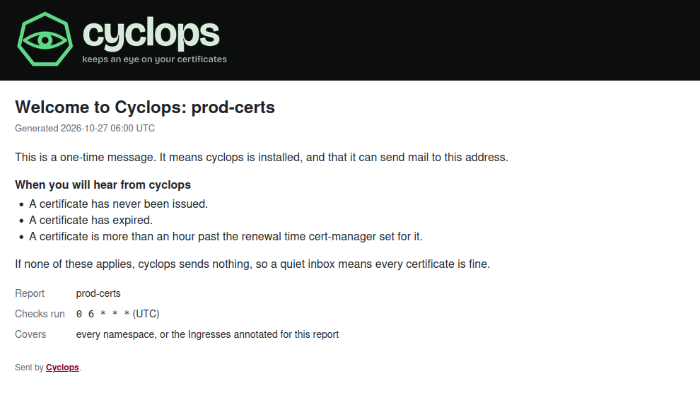
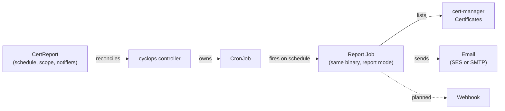
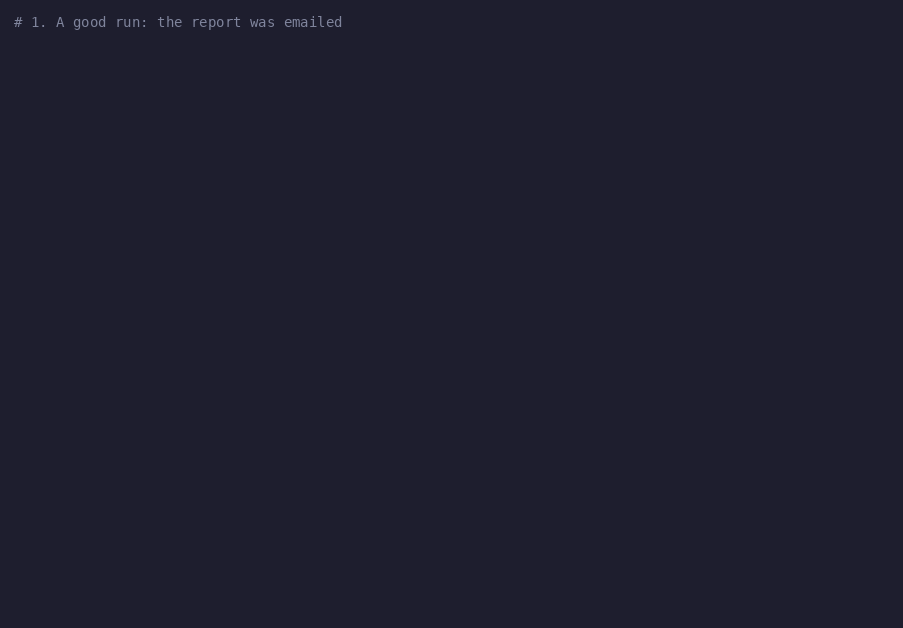

<h1 align="center"></h1>
<p align="center"><sub>The one-time welcome email (planned), rendered from the built-in template with sample data.</sub></p>

A backstop for [cert-manager](https://cert-manager.io): a daily report of certificates that are
expired, never issued, or overdue for renewal, so a silently failing renewal gets noticed before it
becomes an outage.

cyclops is a Kubernetes controller that watches cert-manager `Certificate` resources. "Overdue"
means past the renewal time cert-manager set for the certificate. Reports go out by email (SES or
SMTP); webhook delivery is planned.

cyclops only sends a report when something needs attention: a healthy cluster stays quiet. A
one-time welcome message per report configuration, to explain this and prove delivery works, is
planned.

> [!NOTE]
> **Status: beta, in development.** The API is still `v1alpha1` and can change between releases.
> Install it with Helm from the published chart. The full path has run on a local kind cluster with
> a fake mail server, installed from the repo's manifests: a `CertReport` becomes a CronJob, a run
> emails the certificates that need attention, a healthy run sends nothing, and a failed run shows
> up on the `CertReport`. Not built yet: the welcome message and the webhook notifier. Real SMTP
> authentication, STARTTLS and SES have only been tested with fakes, and installing from the
> published chart has not been tested end to end yet. See [Status](#status),
> [Install the beta](#install-the-beta) and [Try it on kind](#try-it-on-kind).

## How it works



1. You create a cluster-scoped `CertReport` describing the schedule, what to cover (namespaces, or
   annotated Ingresses) and who to notify.
2. The controller keeps a Kubernetes `CronJob` in sync with it.
3. On schedule, the CronJob runs cyclops in **report mode**: it lists the cert-manager
   `Certificate`s in scope (every namespace by default) and picks out the ones that need attention. If there are any, it sends the report
   to each notifier (only `Email` exists today). If there are none, it sends nothing.
4. Planned: when a `CertReport` is first created, cyclops sends a one-time welcome message that
   explains when cyclops emails you. This also checks that delivery works.

For certificates that are due, the report also shows cert-manager's own diagnostics (failed
attempts, ACME state, and the failure reason word for word), so you can see why renewal isn't
happening. For now these come from ACME issuers only; a certificate from a CA, Vault or
self-signed issuer is listed without a reason.

## Architecture

### Components

cyclops has two kinds of parts: objects stored in the Kubernetes API, which are data and run
nothing, and Pods, which do the work.

| Component | Kind | Role |
|---|---|---|
| `CertReport` | API object (CRD, cluster-scoped) | The user's configuration: schedule, namespaces, notifiers. Defined by the CRD. |
| `CronJob` | API object | Holds the schedule and the report Pod template. Created and kept in sync by the controller, and owned by its `CertReport`. |
| `Job` | API object | One per run, created from the CronJob by Kubernetes. Also used for the one-off welcome message. |
| State `ConfigMap` | API object | `cyclops-state-<name>`: records whether the welcome message was sent. Owned by the `CertReport`. |
| Controller | Pod (Deployment, always on) | Reconciles `CertReport`s into CronJobs, sets status conditions, and starts the welcome Job. Never reads certificates and never sends mail. |
| Report Pod | Pod (one-shot, per run) | The same binary in report mode. Lists certificates, decides what to report, renders and sends the message, then exits. |

One controller Pod serves any number of `CertReport`s. Each `CertReport` gets its own CronJob and
state ConfigMap. Deleting a `CertReport` removes everything it owns through owner references, so
no finalizers are needed.

### Lifecycle

**Install** (`helm install`, or `make deploy`), in order:

1. The CRD is registered with the API server.
2. The ServiceAccounts and the RBAC are created in the cyclops namespace (`cyclops-system`).
   `make deploy` creates the namespace; with Helm you create it first.
3. The mail ConfigMap is created: by the chart from its values, or by the operator when using
   `make deploy`. The operator always creates the credentials Secret, if one is needed (see
   [ADR 0014](docs/decisions/0014-notifier-credentials.md)). cert-manager must already be installed.
4. The controller Deployment starts and begins watching `CertReport`s.

**Runtime**, for each `CertReport`:

1. A user creates the `CertReport`.
2. The controller creates the owned CronJob and sets status conditions (`ScheduleValid`,
   `NamespacesFound`, `CredentialsFound`, `ReportSucceeding`, `TemplateValid`). If no welcome message has been sent, it
   also creates a one-off welcome Job. (The welcome Job is designed but not built yet; see
   [Status](#status).)
3. When the schedule fires, Kubernetes' built-in CronJob controller creates a Job.
4. The Job starts a report Pod, which lists the `Certificate`s in scope, evaluates them, and sends
   the report if anything needs attention.
5. The Pod exits. Kubernetes keeps finished Jobs according to the CronJob's history limits.
6. The controller reads the CronJob's status and sets `ReportSucceeding`, so a failed run is
   visible on the `CertReport` ([ADR 0019](docs/decisions/0019-failed-run-visibility.md)).

### Identities and permissions

The controller and the report Pod run under separate ServiceAccounts, so neither holds the other's
privileges. The CR and the CronJob are data and hold no permissions of their own.

| Actor | ServiceAccount | Access |
|---|---|---|
| Controller | `cyclops-controller-manager` | Read and write `CertReport`s and their status. Manage the CronJob, Jobs and state ConfigMap in `cyclops-system`. Read the Secrets, ConfigMaps and Namespaces it validates (the Namespace check is cluster-wide). Create Events. No access to certificates. |
| Report Pod | `cyclops-report` | Read-only: `get`/`list` Certificates, CertificateRequests, Orders and Challenges; `get` Ingresses (for annotation mode); `get` its `CertReport`; `get` ConfigMaps in `cyclops-system` for a custom template. No write access. |
| CronJob scheduling | Kubernetes' built-in CronJob controller | Creates Jobs from the CronJob. Nothing to configure. |

The manager's role is generated from `+kubebuilder:rbac` markers. The report Pod's role is written
by hand in [`config/rbac/report_*.yaml`](config/rbac), since the markers only describe the manager.

Mail delivery is not governed by Kubernetes RBAC. The report Pod receives its SMTP credentials as
environment variables from the install-level Secret, or uses an ambient AWS identity for SES (for
example IRSA on the `cyclops-report` ServiceAccount). The controller never reads the mail password
([ADR 0014](docs/decisions/0014-notifier-credentials.md)).

## Status

| Piece | State |
|---|---|
| Architecture decisions | Recorded in [`docs/decisions/`](docs/decisions/README.md); a few still open |
| Deciding which certificates to report (`internal/report`) | Done, tested |
| Converting cert-manager objects (`internal/certmanager`) | Done, tested |
| Listing certificates from the cluster (`internal/certmanager`) | Done, tested (unit + cluster) |
| `CertReport` → `CronJob` reconciliation (`internal/controller`) | Done, tested, and run on kind: owned CronJob, `ScheduleValid`, `CredentialsFound`, `NamespacesFound`, `ReportSucceeding` |
| `TemplateValid` condition | Done, unit-tested. Checks that the template ConfigMap and key exist and that the template parses (the chart-wide default included); a misspelled field name is only caught when the template runs ([ADR 0018](docs/decisions/0018-certreport-schema.md)) |
| Report mode (`cyclops report`, run by the CronJob's Pod) | Done, unit-tested, and run on kind against a fake SMTP server. Not yet handled: the `--welcome` message text |
| Report Pod RBAC (`config/rbac/report_*.yaml`) | Done, works on kind |
| Email rendering (`internal/render`) | Done, tested |
| Email sending: SMTP (`internal/email`) | Done, tested against an in-process fake server |
| Email sending: SES (`internal/email`) | Done, tested against a fake client |
| Email sending: env-based provider selection, `FromEnv` (`internal/email`) | Done, tested |
| Webhook sending | Not started; design open ([ADR 0017](docs/decisions/0017-webhook-notifier.md)) |
| Welcome message | Not started |
| Signal when a report run fails | Done, run on kind: `ReportSucceeding` condition plus a Warning Event ([ADR 0019](docs/decisions/0019-failed-run-visibility.md)). It says that a run failed, not why; the Job's logs have the cause |
| Helm chart | Published as `oci://ghcr.io/sakshitposting-irl/charts/cyclops` (`0.1.0-beta.2`). It lints and renders; installing the published chart has not been tested end to end. [ADR 0016](docs/decisions/README.md) is still open (chart versioning, whether the kustomize manifests stay a second install path) |
| Published image | `v0.1.0-beta.2`, for linux/amd64 and linux/arm64 |
| Release pipeline (`.github/workflows/release.yml`) | Done, first used for `v0.1.0-beta.2`: pushing a `v*` tag tests, then publishes the multi-arch image, the chart and a GitHub pre-release |
| `CertReport` schema | Done ([ADR 0018](docs/decisions/0018-certreport-schema.md)) |
| Ingress annotation mode (`spec.ingressAnnotationMode`) | Done, unit-tested and run on kind (shared secrets, dangling annotations, healthy-only) ([ADR 0020](docs/decisions/0020-ingress-annotation-mode.md)) |

## Documentation

- [**Design decisions**](docs/decisions/README.md): what's been decided, with pros and cons, and
  what's still open.
- [**Internals**](docs/README.md#internals): how the code works (startup, leader election, the
  report pipeline).
- [**Helm chart**](charts/cyclops/README.md): every value, and how to customise the email template.

## Development

**Prerequisites:** Go 1.26+, Docker, `kubectl`, and a Kubernetes cluster with cert-manager
installed (for example [kind](https://kind.sigs.k8s.io)). Tool binaries such as `controller-gen`
and `golangci-lint` are downloaded into `bin/` automatically.

```sh
make build        # build bin/manager
make test         # unit tests (envtest)
make lint         # golangci-lint
make help         # list all targets
```

To run the controller from your host against your current kubeconfig context, pass the flags it
requires (`make run` passes none, so it exits asking for them):

```sh
POD_NAMESPACE=cyclops-system go run ./cmd --report-image=<image> --leader-elect=false
```

Cluster validation tests run the report pipeline against a real cluster using the fixtures in
`test/cluster/testdata/`. They need a kind cluster with cert-manager installed, create and delete
their own `cyclops-test-*` namespaces, and refuse to run on any context not named `kind-*`:

```sh
make test-cluster                              # uses the kind-cyclops context
make test-cluster CLUSTER_CONTEXT=kind-other   # or pick another kind cluster
```

After editing `api/v1alpha1/*_types.go` or `+kubebuilder` markers, regenerate CRDs, RBAC and
DeepCopy code:

```sh
make manifests generate
```

## Install the beta

> [!WARNING]
> `v0.1.0-beta.2` is a beta. It has no welcome message and no webhook (see [Status](#status)).
> Real SMTP authentication, STARTTLS and SES have only been tested with fakes, and installing from
> the published chart has not been tested end to end yet. Try it on a non-production cluster first,
> or on kind with [the section below](#try-it-on-kind).

**Prerequisites:** a cluster with [cert-manager](https://cert-manager.io) installed, `kubectl`, and
[Helm](https://helm.sh) 3.8 or newer (needed for OCI charts).

The chart is published at `oci://ghcr.io/sakshitposting-irl/charts/cyclops` and the image, for
linux/amd64 and linux/arm64, at `ghcr.io/sakshitposting-irl/cyclops`. The chart's `appVersion` is
the image tag, so a chart version installs the matching image.

**1. Create the namespace, and the mail credentials only if you need them.** If your SMTP server
wants a login (or SES should use static keys), create the Secret yourself. Credentials never go
through chart values ([ADR 0014](docs/decisions/0014-notifier-credentials.md)):

```sh
kubectl create namespace cyclops-system

kubectl -n cyclops-system create secret generic cyclops-mail-credentials \
  --from-literal=username=<user> --from-literal=password=<password>      # SES: access-key-id, secret-access-key
```

**2. Install the chart.** Mail delivery is configured once per install, in the chart values. A
`CertReport` only says who gets the email:

```sh
helm install cyclops oci://ghcr.io/sakshitposting-irl/charts/cyclops --version 0.1.0-beta.2 \
  --namespace cyclops-system \
  --set email.smtp.host=smtp.example.com \
  --set email.smtp.credentialsSecretName=cyclops-mail-credentials   # leave out if no login is needed
```

SMTP uses STARTTLS on port 587 by default; see `email.smtp.tls` and `email.smtp.port`. For an
unauthenticated relay use `--set email.smtp.tls=None` and no credentials Secret (the chart rejects
`None` together with one). For SES, set `email.provider=SES` and `email.ses.region`, and give the
report ServiceAccount an AWS identity, for example an IRSA annotation through
`reportServiceAccount.annotations`, or name a Secret in `email.ses.credentialsSecretName`.

This creates the `CertReport` CRD, both ServiceAccounts with their RBAC, the mail ConfigMap and the
controller Deployment. Every value, and how to customise the email template, is in the
[chart README](charts/cyclops/README.md). Check that the controller is running:

```sh
kubectl -n cyclops-system get pods
```

**3. Create a `CertReport`.**

```sh
kubectl apply -f - <<'EOF'
apiVersion: cyclops.sakshitposting-irl.github.io/v1alpha1
kind: CertReport
metadata: {name: cluster-certs}
spec:
  schedule: "0 8 * * *"             # UTC; this is the default
  namespaces: []                    # empty means every namespace
  notifiers:
    - type: Email
      email: {from: cyclops@example.com, to: [platform@example.com]}
EOF
```

**4. Check it.**

```sh
kubectl get certreport,cronjob -A
kubectl get certreport cluster-certs -o jsonpath='{range .status.conditions[*]}{.type}={.status} ({.reason}){"\n"}{end}'
```

`ScheduleValid`, `NamespacesFound`, `CredentialsFound` and `TemplateValid` should all be `True`.
`ReportSucceeding` is `Unknown` (`NoRunsYet`) until the first scheduled run. To send a report now
instead of waiting for 08:00, run the CronJob once and read its logs:

```sh
kubectl -n cyclops-system create job --from=cronjob/cyclops-cluster-certs first-run
kubectl -n cyclops-system logs job/first-run
```

A healthy cluster logs "nothing to report" and sends no email. That is by design.

**Without Helm.** The kustomize manifests in `config/` still work: follow
[Deploying your own build](#deploying-your-own-build), using the published image
(`ghcr.io/sakshitposting-irl/cyclops:v0.1.0-beta.2`) instead of building one. Whether they stay a
second supported install path is not decided ([ADR 0016](docs/decisions/README.md)).

### When a report run fails

A healthy day sends no email, so a broken report run would be silent too. To avoid that, the
controller reads the owned CronJob's status and sets `ReportSucceeding` on the `CertReport`:
`True` when the latest scheduled run succeeded, `False` (reason `LastRunFailed`, plus one Warning
Event) when it failed, and `Unknown` while there has been no run yet or the CronJob is suspended.
While a run is in progress the previous value is kept.



The recording is a real run on kind (`hack/demo/failed-run.sh`). The condition only says that a run
failed. For the cause, read the Job's logs:

```sh
kubectl get certreport cluster-certs -o jsonpath='{.status.conditions[?(@.type=="ReportSucceeding")].message}'
kubectl -n cyclops-system logs job/<failed-job>
```

This is a plain status condition, so it works without Prometheus or any other monitoring stack.
If you do run one, you can alert on the condition yourself; cyclops ships no alert rules.

Only scheduled runs count. A Job you create by hand with `kubectl create job --from=cronjob/...`
does not change `ReportSucceeding`.

**Uninstall.** Delete the reports first, so Kubernetes removes the CronJobs they own, then the
release:

```sh
kubectl delete certreport --all
helm uninstall cyclops -n cyclops-system
```

The chart keeps the CRD when it is uninstalled (`crd.keep`, default `true`), so any `CertReport` you
did not delete survives. To remove everything, including the credentials Secret you created:

```sh
kubectl delete crd certreports.cyclops.sakshitposting-irl.github.io
kubectl delete namespace cyclops-system
```

### Ingress annotation mode

Set `spec.ingressAnnotationMode: true` (exclusive with `spec.namespaces`) and annotate each Ingress
you want in that report with `cyclops.sakshitposting-irl.github.io/cr-name: <CertReport name>`. The
Certificates behind its `tls[].secretName` entries are reported.

```yaml
apiVersion: cyclops.sakshitposting-irl.github.io/v1alpha1
kind: CertReport
metadata: {name: prod-certs}
spec:
  ingressAnnotationMode: true       # cannot be combined with namespaces
  notifiers:
    - type: Email
      email: {from: cyclops@example.com, to: [platform@example.com]}
---
apiVersion: networking.k8s.io/v1
kind: Ingress
metadata:
  name: shop
  namespace: tenant
  annotations:
    cyclops.sakshitposting-irl.github.io/cr-name: prod-certs
spec:
  tls: [{hosts: [shop.example.com], secretName: shop-tls}]   # the Certificate with this secretName is reported
```

Each row in the report names the Ingress it came from. Report Pods need to read Ingresses; the
Helm chart grants this unless you set `rbac.ingressAccess: false`.

An annotation that names a CertReport that does not exist, or has a typo in the key or the name, fails
silently: the Ingress is just never reported and nothing is logged; checking the annotation is up to the
Ingress owner. Anyone who can edit an Ingress can send that Ingress's certificate details to a
CertReport's recipients, so restrict who can edit Ingresses.

## Try it on kind

This runs the whole path on your machine with a fake mail server, so nothing is emailed for real.
It needs Docker, `kind` and `kubectl`, and uses `test/cluster/testdata/fixtures.yaml`, which
includes a certificate that can never be issued.

```sh
kind create cluster --name cyclops
kubectl apply -f https://github.com/cert-manager/cert-manager/releases/download/v1.21.2/cert-manager.yaml
kubectl -n cert-manager wait --for=condition=Available deployment --all --timeout=240s

docker build -t cyclops:dev . && kind load docker-image cyclops:dev --name cyclops
# The image appears twice in the manifests (the Deployment and --report-image), so substitute both:
make kustomize
bin/kustomize build config/default | sed 's#controller:latest#cyclops:dev#g' | kubectl apply --server-side -f -

kubectl apply -f hack/kind/mail.yaml                    # MailHog and the mail settings
kubectl -n mailhog rollout status deploy/mailhog        # wait for it, or the first run cannot connect
kubectl apply -f test/cluster/testdata/fixtures.yaml    # test certificates
```

Create a `CertReport` and trigger a run without waiting for its schedule:

```sh
kubectl apply -f - <<'EOF'
apiVersion: cyclops.sakshitposting-irl.github.io/v1alpha1
kind: CertReport
metadata: {name: kind-test}
spec:
  namespaces: [cyclops-test-a, cyclops-test-b]
  notifiers:
    - type: Email
      email: {from: cyclops@example.com, to: [platform@example.com]}
EOF

kubectl -n cyclops-system create job --from=cronjob/cyclops-kind-test manual-1
kubectl -n cyclops-system logs job/manual-1
kubectl -n mailhog port-forward svc/mailhog 8025:8025   # then open http://localhost:8025
```

The report lists `cyclops-test-b/broken` as never issued. Limit the `CertReport` to
`cyclops-test-a` and run another Job to see a healthy run: it logs "nothing to report" and sends
nothing. Remove everything with `kind delete cluster --name cyclops`.

## Deploying your own build

To run a build of your own instead of the published image (or to deploy the published image from
the manifests instead of the chart, set `IMG=ghcr.io/sakshitposting-irl/cyclops:v0.1.0-beta.2` and
skip the build and push line):

```sh
export IMG=<registry>/cyclops:<tag>

make docker-build docker-push IMG=$IMG   # build and push the image
make install                             # install the CRDs
make deploy IMG=$IMG                     # deploy the controller
kubectl apply -k config/samples/         # create a sample CertReport
```

Before the first report can run:

- **Mail settings.** Create the ConfigMap `cyclops-mail-config` in `cyclops-system` with the
  non-secret settings, such as `CYCLOPS_EMAIL_PROVIDER` (`SMTP` or `SES`) and the host or region
  (variable names are in [`internal/email/env.go`](internal/email/env.go)). The report Pod will not
  start without this ConfigMap.
- **Credentials (optional).** Needed only if your SMTP server wants a login or SES should use static
  keys. Create a Secret in `cyclops-system` with `username` and `password` (SMTP) or
  `access-key-id` and `secret-access-key` (SES), and name it in the manager's
  `--credentials-secret` argument in `config/manager/manager.yaml`. Without that argument, no
  credentials are used (an unauthenticated relay, or SES through IRSA or Pod Identity). See
  [ADR 0014](docs/decisions/0014-notifier-credentials.md). When a Secret is named, the
  `CredentialsFound` condition on the `CertReport` shows whether it is usable.
- **Report image.** `make deploy IMG=...` rewrites the manager's `image:` but not its
  `--report-image` argument in `config/manager/manager.yaml`. Edit that argument to the same image,
  or the report Pods will run `controller:latest`.

Check what the controller made:

```sh
kubectl get certreport,cronjob -A
kubectl get certreport <name> -o jsonpath='{.status.conditions}'
```

> [!NOTE]
> The path has been run end to end only on kind with an unauthenticated fake SMTP server. Real
> SMTP authentication, STARTTLS and SES have only been tested with fakes, so expect rough edges.

If you hit RBAC errors, you may need cluster-admin privileges.

To remove everything:

```sh
kubectl delete -k config/samples/
make undeploy
make uninstall
```

## Contributing

Contributions are welcome. Read [CONTRIBUTING.md](CONTRIBUTING.md) first (design decisions live in
[`docs/decisions/`](docs/decisions/README.md)), and note the [Code of Conduct](CODE_OF_CONDUCT.md).

## License

Licensed under the Apache License, Version 2.0. See [LICENSE](LICENSE).
