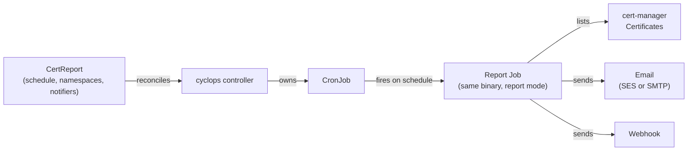

# cyclops

A Kubernetes controller that watches [cert-manager](https://cert-manager.io) `Certificate`
resources and reports certificates that are expired, were never issued, or are overdue for renewal
(past the renewal time cert-manager set for them). Reports go out by email (SES or SMTP) or
webhook.

cyclops only sends a report when something needs attention: a healthy cluster stays quiet. Each
new report configuration gets a one-time welcome message that explains this.

cert-manager renews certificates automatically. cyclops is the backstop for when that renewal
silently fails.

> [!NOTE]
> **Status: in development.** The controller creates and maintains the CronJob and reports its own
> health in status conditions, and the report run is written and unit-tested. It hasn't been run
> on a real cluster yet, and the welcome message isn't built. Most of the design is decided.
> Webhook details, packaging and a few other items are still open. See [Status](#status).

## How it works



1. You create a cluster-scoped `CertReport` describing the schedule, which namespaces to cover and who
   to notify.
2. The controller keeps a Kubernetes `CronJob` in sync with it.
3. On schedule, the CronJob runs cyclops in **report mode**: it lists every cert-manager
   `Certificate` and picks out the ones that need attention. If there are any, it sends the report
   to each notifier (`Email` or `Webhook`). If there are none, it sends nothing.
4. When a `CertReport` is first created, cyclops sends a one-time welcome message with the current
   findings. This also checks that delivery works.

For certificates that are due, the report also shows cert-manager's own diagnostics (failed
attempts, ACME state, and the failure reason word for word), so you can see why renewal isn't
happening.

## Architecture

### Components

cyclops has two kinds of parts: objects stored in the Kubernetes API, which are data and run
nothing, and Pods, which do the work.

| Component | Kind | Role |
|---|---|---|
| `CertReport` | API object (CRD, cluster-scoped) | The user's configuration: schedule, namespaces, notifiers. Defined by the CRD. |
| `CronJob` | API object | Holds the schedule and the report Pod template. Created and kept in sync by the controller, and owned by its `CertReport`. |
| `Job` | API object | One per run, created from the CronJob by Kubernetes. Also used for the one-off welcome message. |
| State `ConfigMap` | API object | `cyclops-state-<name>`: records whether the welcome message was sent. Owned by the `CertReport`. |
| Controller | Pod (Deployment, always on) | Reconciles `CertReport`s into CronJobs, sets status conditions, and starts the welcome Job. Never reads certificates and never sends mail. |
| Report Pod | Pod (one-shot, per run) | The same binary in report mode. Lists certificates, decides what to report, renders and sends the message, then exits. |

One controller Pod serves any number of `CertReport`s. Each `CertReport` gets its own CronJob and
state ConfigMap. Deleting a `CertReport` removes everything it owns through owner references, so
no finalizers are needed.

### Lifecycle

**Install** (`make deploy`), in order:

1. The CRD is registered with the API server.
2. The `cyclops-system` namespace, the ServiceAccounts and the RBAC are created.
3. The operator creates the mail ConfigMap and credentials Secret (see
   [ADR 0014](docs/decisions/0014-notifier-credentials.md)). cert-manager must already be installed.
4. The controller Deployment starts and begins watching `CertReport`s.

**Runtime**, for each `CertReport`:

1. A user creates the `CertReport`.
2. The controller creates the owned CronJob and sets status conditions (`ScheduleValid`,
   `NamespacesFound`, `CredentialsFound`, `TemplateValid`). If no welcome message has been sent, it
   also creates a one-off welcome Job. (`TemplateValid` and the welcome Job are designed but not
   built yet; see [Status](#status).)
3. When the schedule fires, Kubernetes' built-in CronJob controller creates a Job.
4. The Job starts a report Pod, which lists the `Certificate`s in scope, evaluates them, and sends
   the report if anything needs attention.
5. The Pod exits. Kubernetes keeps finished Jobs according to the CronJob's history limits.

### Identities and permissions

The controller and the report Pod run under separate ServiceAccounts, so neither holds the other's
privileges. The CR and the CronJob are data and hold no permissions of their own.

| Actor | ServiceAccount | Access |
|---|---|---|
| Controller | `cyclops-controller-manager` | Read and write `CertReport`s and their status. Manage the CronJob, Jobs and state ConfigMap in `cyclops-system`. Read the Secrets, ConfigMaps and Namespaces it validates (the Namespace check is cluster-wide). Create Events. No access to certificates. |
| Report Pod | `cyclops-report` | Read-only: `get`/`list` Certificates, CertificateRequests, Orders and Challenges; `get` its `CertReport`; `get` ConfigMaps in `cyclops-system` for a custom template. No write access. |
| CronJob scheduling | Kubernetes' built-in CronJob controller | Creates Jobs from the CronJob. Nothing to configure. |

The manager's role is generated from `+kubebuilder:rbac` markers. The report Pod's role is written
by hand in [`config/rbac/report_*.yaml`](config/rbac), since the markers only describe the manager.

Mail delivery is not governed by Kubernetes RBAC. The report Pod receives its SMTP credentials as
environment variables from the install-level Secret, or uses an ambient AWS identity for SES (for
example IRSA on the `cyclops-report` ServiceAccount). The controller never reads the mail password
([ADR 0014](docs/decisions/0014-notifier-credentials.md)).

## Status

| Piece | State |
|---|---|
| Architecture decisions | Recorded in [`docs/decisions/`](docs/decisions/README.md); a few still open |
| Deciding which certificates to report (`internal/report`) | Done, tested |
| Converting cert-manager objects (`internal/certmanager`) | Done, tested |
| Listing certificates from the cluster (`internal/certmanager`) | Done, tested (unit + cluster) |
| `CertReport` → `CronJob` reconciliation (`internal/controller`) | Done, tested: owned CronJob, `ScheduleValid`, `CredentialsFound`, `NamespacesFound` |
| `TemplateValid` condition | Not started |
| Report mode (`cyclops report`, run by the CronJob's Pod) | Done, unit-tested with a fake client and sender; not yet run on a cluster. Not yet handled: the `--welcome` message text |
| Report Pod RBAC (`config/rbac/report_*.yaml`) | Written, not yet tried on a cluster |
| Email rendering (`internal/render`) | Done, tested |
| Email sending: SMTP (`internal/email`) | Done, tested against an in-process fake server |
| Email sending: SES (`internal/email`) | Done, tested against a fake client |
| Email sending: env-based provider selection, `FromEnv` (`internal/email`) | Done, tested |
| Webhook sending | Not started; design open ([ADR 0017](docs/decisions/0017-webhook-notifier.md)) |
| Welcome message | Not started |
| `CertReport` schema | Done ([ADR 0018](docs/decisions/0018-certreport-schema.md)) |

## Documentation

- [**Design decisions**](docs/decisions/README.md): what's been decided, with pros and cons, and
  what's still open.
- [**Internals**](docs/README.md#internals): how the code works (startup, leader election, the
  report pipeline).

## Development

**Prerequisites:** Go 1.26+, Docker, `kubectl`, and a Kubernetes cluster with cert-manager
installed (for example [kind](https://kind.sigs.k8s.io)). Tool binaries such as `controller-gen`
and `golangci-lint` are downloaded into `bin/` automatically.

```sh
make build        # build bin/manager
make test         # unit tests (envtest)
make lint         # golangci-lint
make help         # list all targets
```

To run the controller from your host against your current kubeconfig context, pass the flags it
requires (`make run` passes none, so it exits asking for them):

```sh
POD_NAMESPACE=cyclops-system go run ./cmd/main.go --report-image=<image> --leader-elect=false
```

Cluster validation tests run the report pipeline against a real cluster using the fixtures in
`test/cluster/testdata/`. They need a kind cluster with cert-manager installed, create and delete
their own `cyclops-test-*` namespaces, and refuse to run on any context not named `kind-*`:

```sh
make test-cluster                              # uses the kind-cyclops context
make test-cluster CLUSTER_CONTEXT=kind-other   # or pick another kind cluster
```

After editing `api/v1alpha1/*_types.go` or `+kubebuilder` markers, regenerate CRDs, RBAC and
DeepCopy code:

```sh
make manifests generate
```

## Deploying to a cluster

```sh
export IMG=<registry>/cyclops:<tag>

make docker-build docker-push IMG=$IMG   # build and push the image
make install                             # install the CRDs
make deploy IMG=$IMG                     # deploy the controller
kubectl apply -k config/samples/         # create a sample CertReport
```

Before the first report can run:

- **Mail settings.** Create the ConfigMap `cyclops-mail-config` in `cyclops-system` with the
  non-secret settings, such as `CYCLOPS_EMAIL_PROVIDER` (`SMTP` or `SES`) and the host or region
  (variable names are in [`internal/email/env.go`](internal/email/env.go)). The report Pod will not
  start without this ConfigMap.
- **Credentials (optional).** Needed only if your SMTP server wants a login or SES should use static
  keys. Create a Secret in `cyclops-system` with `username` and `password` (SMTP) or
  `access-key-id` and `secret-access-key` (SES), and name it in the manager's
  `--credentials-secret` argument in `config/manager/manager.yaml`. Without that argument, no
  credentials are used (an unauthenticated relay, or SES through IRSA or Pod Identity). See
  [ADR 0014](docs/decisions/0014-notifier-credentials.md). When a Secret is named, the
  `CredentialsFound` condition on the `CertReport` shows whether it is usable.
- **Report image.** `make deploy IMG=...` rewrites the manager's `image:` but not its
  `--report-image` argument in `config/manager/manager.yaml`. Edit that argument to the same image,
  or the report Pods will run `controller:latest`.

Check what the controller made:

```sh
kubectl get certreport,cronjob -A
kubectl get certreport <name> -o jsonpath='{.status.conditions}'
```

> [!NOTE]
> The full path has only been tested with fakes so far. Expect rough edges on a first real run.

If you hit RBAC errors, you may need cluster-admin privileges.

To remove everything:

```sh
kubectl delete -k config/samples/
make undeploy
make uninstall
```

## License

Licensed under the Apache License, Version 2.0. See [LICENSE](LICENSE).
