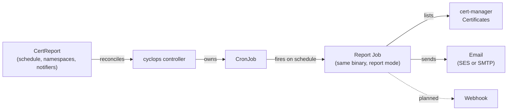

# cyclops

A Kubernetes controller that watches [cert-manager](https://cert-manager.io) `Certificate`
resources and reports certificates that are expired, were never issued, or are overdue for renewal
(past the renewal time cert-manager set for them). Reports go out by email (SES or SMTP);
webhook delivery is planned.

cyclops only sends a report when something needs attention: a healthy cluster stays quiet. A
one-time welcome message per report configuration, to explain this and prove delivery works, is
planned.

cert-manager renews certificates automatically. cyclops is the backstop for when that renewal
silently fails.

> [!NOTE]
> **Status: alpha, in development.** The full path works on a local kind cluster with a fake mail
> server: a `CertReport` becomes a CronJob, a run emails the certificates that need attention, and
> a healthy run sends nothing. Not built yet: the welcome message, the webhook notifier, a Helm
> chart and published image, and any signal when a report run itself fails. Real SMTP
> authentication, STARTTLS and SES have only been tested with fakes. See [Status](#status),
> [Install the alpha](#install-the-alpha) and [Try it on kind](#try-it-on-kind).

## How it works



1. You create a cluster-scoped `CertReport` describing the schedule, which namespaces to cover and who
   to notify.
2. The controller keeps a Kubernetes `CronJob` in sync with it.
3. On schedule, the CronJob runs cyclops in **report mode**: it lists every cert-manager
   `Certificate` and picks out the ones that need attention. If there are any, it sends the report
   to each notifier (only `Email` exists today). If there are none, it sends nothing.
4. Planned: when a `CertReport` is first created, cyclops sends a one-time welcome message with the
   current findings. This also checks that delivery works.

For certificates that are due, the report also shows cert-manager's own diagnostics (failed
attempts, ACME state, and the failure reason word for word), so you can see why renewal isn't
happening. For now these come from ACME issuers only; a certificate from a CA, Vault or
self-signed issuer is listed without a reason.

## Architecture

### Components

cyclops has two kinds of parts: objects stored in the Kubernetes API, which are data and run
nothing, and Pods, which do the work.

| Component | Kind | Role |
|---|---|---|
| `CertReport` | API object (CRD, cluster-scoped) | The user's configuration: schedule, namespaces, notifiers. Defined by the CRD. |
| `CronJob` | API object | Holds the schedule and the report Pod template. Created and kept in sync by the controller, and owned by its `CertReport`. |
| `Job` | API object | One per run, created from the CronJob by Kubernetes. Also used for the one-off welcome message. |
| State `ConfigMap` | API object | `cyclops-state-<name>`: records whether the welcome message was sent. Owned by the `CertReport`. |
| Controller | Pod (Deployment, always on) | Reconciles `CertReport`s into CronJobs, sets status conditions, and starts the welcome Job. Never reads certificates and never sends mail. |
| Report Pod | Pod (one-shot, per run) | The same binary in report mode. Lists certificates, decides what to report, renders and sends the message, then exits. |

One controller Pod serves any number of `CertReport`s. Each `CertReport` gets its own CronJob and
state ConfigMap. Deleting a `CertReport` removes everything it owns through owner references, so
no finalizers are needed.

### Lifecycle

**Install** (`make deploy`), in order:

1. The CRD is registered with the API server.
2. The `cyclops-system` namespace, the ServiceAccounts and the RBAC are created.
3. The operator creates the mail ConfigMap and credentials Secret (see
   [ADR 0014](docs/decisions/0014-notifier-credentials.md)). cert-manager must already be installed.
4. The controller Deployment starts and begins watching `CertReport`s.

**Runtime**, for each `CertReport`:

1. A user creates the `CertReport`.
2. The controller creates the owned CronJob and sets status conditions (`ScheduleValid`,
   `NamespacesFound`, `CredentialsFound`, `TemplateValid`). If no welcome message has been sent, it
   also creates a one-off welcome Job. (`TemplateValid` and the welcome Job are designed but not
   built yet; see [Status](#status).)
3. When the schedule fires, Kubernetes' built-in CronJob controller creates a Job.
4. The Job starts a report Pod, which lists the `Certificate`s in scope, evaluates them, and sends
   the report if anything needs attention.
5. The Pod exits. Kubernetes keeps finished Jobs according to the CronJob's history limits.

### Identities and permissions

The controller and the report Pod run under separate ServiceAccounts, so neither holds the other's
privileges. The CR and the CronJob are data and hold no permissions of their own.

| Actor | ServiceAccount | Access |
|---|---|---|
| Controller | `cyclops-controller-manager` | Read and write `CertReport`s and their status. Manage the CronJob, Jobs and state ConfigMap in `cyclops-system`. Read the Secrets, ConfigMaps and Namespaces it validates (the Namespace check is cluster-wide). Create Events. No access to certificates. |
| Report Pod | `cyclops-report` | Read-only: `get`/`list` Certificates, CertificateRequests, Orders and Challenges; `get` its `CertReport`; `get` ConfigMaps in `cyclops-system` for a custom template. No write access. |
| CronJob scheduling | Kubernetes' built-in CronJob controller | Creates Jobs from the CronJob. Nothing to configure. |

The manager's role is generated from `+kubebuilder:rbac` markers. The report Pod's role is written
by hand in [`config/rbac/report_*.yaml`](config/rbac), since the markers only describe the manager.

Mail delivery is not governed by Kubernetes RBAC. The report Pod receives its SMTP credentials as
environment variables from the install-level Secret, or uses an ambient AWS identity for SES (for
example IRSA on the `cyclops-report` ServiceAccount). The controller never reads the mail password
([ADR 0014](docs/decisions/0014-notifier-credentials.md)).

## Status

| Piece | State |
|---|---|
| Architecture decisions | Recorded in [`docs/decisions/`](docs/decisions/README.md); a few still open |
| Deciding which certificates to report (`internal/report`) | Done, tested |
| Converting cert-manager objects (`internal/certmanager`) | Done, tested |
| Listing certificates from the cluster (`internal/certmanager`) | Done, tested (unit + cluster) |
| `CertReport` → `CronJob` reconciliation (`internal/controller`) | Done, tested, and run on kind: owned CronJob, `ScheduleValid`, `CredentialsFound`, `NamespacesFound` |
| `TemplateValid` condition | Not started |
| Report mode (`cyclops report`, run by the CronJob's Pod) | Done, unit-tested, and run on kind against a fake SMTP server. Not yet handled: the `--welcome` message text |
| Report Pod RBAC (`config/rbac/report_*.yaml`) | Done, works on kind |
| Email rendering (`internal/render`) | Done, tested |
| Email sending: SMTP (`internal/email`) | Done, tested against an in-process fake server |
| Email sending: SES (`internal/email`) | Done, tested against a fake client |
| Email sending: env-based provider selection, `FromEnv` (`internal/email`) | Done, tested |
| Webhook sending | Not started; design open ([ADR 0017](docs/decisions/0017-webhook-notifier.md)) |
| Welcome message | Not started |
| Signal when a report run fails | Not started: a failing run raises no email and no condition |
| Helm chart and published image | Not started ([ADR 0016](docs/decisions/README.md)) |
| `CertReport` schema | Done ([ADR 0018](docs/decisions/0018-certreport-schema.md)) |

## Documentation

- [**Design decisions**](docs/decisions/README.md): what's been decided, with pros and cons, and
  what's still open.
- [**Internals**](docs/README.md#internals): how the code works (startup, leader election, the
  report pipeline).

## Development

**Prerequisites:** Go 1.26+, Docker, `kubectl`, and a Kubernetes cluster with cert-manager
installed (for example [kind](https://kind.sigs.k8s.io)). Tool binaries such as `controller-gen`
and `golangci-lint` are downloaded into `bin/` automatically.

```sh
make build        # build bin/manager
make test         # unit tests (envtest)
make lint         # golangci-lint
make help         # list all targets
```

To run the controller from your host against your current kubeconfig context, pass the flags it
requires (`make run` passes none, so it exits asking for them):

```sh
POD_NAMESPACE=cyclops-system go run ./cmd --report-image=<image> --leader-elect=false
```

Cluster validation tests run the report pipeline against a real cluster using the fixtures in
`test/cluster/testdata/`. They need a kind cluster with cert-manager installed, create and delete
their own `cyclops-test-*` namespaces, and refuse to run on any context not named `kind-*`:

```sh
make test-cluster                              # uses the kind-cyclops context
make test-cluster CLUSTER_CONTEXT=kind-other   # or pick another kind cluster
```

After editing `api/v1alpha1/*_types.go` or `+kubebuilder` markers, regenerate CRDs, RBAC and
DeepCopy code:

```sh
make manifests generate
```

## Install the alpha

> [!WARNING]
> `v0.1.0-alpha.1` is a first alpha, published for linux/amd64 only. It has no welcome message, no
> webhook and no Helm chart, and nothing tells you when a report run itself fails (see
> [Status](#status)). Try it on a non-production cluster first, or on kind with
> [the section below](#try-it-on-kind).

**Prerequisites:** a cluster with [cert-manager](https://cert-manager.io) installed, `kubectl`, and
`git`.

**1. Install cyclops.** The manifests live in this repository, so clone the release and apply them
with the published image. The image appears twice in the manifests (the controller's `image:` and its
`--report-image` argument), so substitute both:

```sh
git clone --branch v0.1.0-alpha.1 https://github.com/sakshitposting-irl/cyclops.git
cd cyclops

IMG=ghcr.io/sakshitposting-irl/cyclops:v0.1.0-alpha.1
kubectl kustomize config/default | sed "s#controller:latest#${IMG}#g" | kubectl apply --server-side -f -
```

This creates the `cyclops-system` namespace, the `CertReport` CRD, both ServiceAccounts with their
RBAC, and the controller Deployment.

**2. Tell cyclops how to send mail.** Create the ConfigMap `cyclops-mail-config` in
`cyclops-system`. The report Pod will not start without it. For SMTP:

```yaml
apiVersion: v1
kind: ConfigMap
metadata: {name: cyclops-mail-config, namespace: cyclops-system}
data:
  CYCLOPS_EMAIL_PROVIDER: SMTP
  CYCLOPS_SMTP_HOST: smtp.example.com
  CYCLOPS_SMTP_PORT: "587"
  CYCLOPS_SMTP_TLS: StartTLS      # StartTLS (default), TLS, or None for an unauthenticated relay
```

For SES, set `CYCLOPS_EMAIL_PROVIDER: SES` and `CYCLOPS_SES_REGION`, and give the
`cyclops-report` ServiceAccount an AWS identity (for example an IRSA annotation). The variable names
are in [`internal/email/env.go`](internal/email/env.go).

**3. Add credentials, only if you need them.** If your SMTP server wants a login (or SES should use
static keys), create the Secret and tell the controller its name. Without this, no credentials are used:

```sh
kubectl -n cyclops-system create secret generic cyclops-mail-credentials \
  --from-literal=username=<user> --from-literal=password=<password>      # SES: access-key-id, secret-access-key

kubectl -n cyclops-system patch deployment cyclops-controller-manager --type json \
  -p '[{"op":"add","path":"/spec/template/spec/containers/0/args/-","value":"--credentials-secret=cyclops-mail-credentials"}]'
```

See [ADR 0014](docs/decisions/0014-notifier-credentials.md) for the reasoning.

**4. Create a `CertReport`.**

```sh
kubectl apply -f - <<'EOF'
apiVersion: cyclops.sakshitposting-irl.github.io/v1alpha1
kind: CertReport
metadata: {name: cluster-certs}
spec:
  schedule: "0 8 * * *"             # UTC; this is the default
  namespaces: []                    # empty means every namespace
  notifiers:
    - type: Email
      email: {from: cyclops@example.com, to: [platform@example.com]}
EOF
```

**5. Check it.**

```sh
kubectl get certreport,cronjob -A
kubectl get certreport cluster-certs -o jsonpath='{range .status.conditions[*]}{.type}={.status} ({.reason}){"\n"}{end}'
```

`ScheduleValid`, `NamespacesFound` and `CredentialsFound` should all be `True`. To send a report now
instead of waiting for 08:00, run the CronJob once and read its logs:

```sh
kubectl -n cyclops-system create job --from=cronjob/cyclops-cluster-certs first-run
kubectl -n cyclops-system logs job/first-run
```

A healthy cluster logs "nothing to report" and sends no email. That is by design.

**Uninstall:** `kubectl delete certreport --all`, then
`kubectl kustomize config/default | sed "s#controller:latest#${IMG}#g" | kubectl delete -f -`.

## Try it on kind

This runs the whole path on your machine with a fake mail server, so nothing is emailed for real.
It needs Docker, `kind` and `kubectl`, and uses `test/cluster/testdata/fixtures.yaml`, which
includes a certificate that can never be issued.

```sh
kind create cluster --name cyclops
kubectl apply -f https://github.com/cert-manager/cert-manager/releases/download/v1.21.2/cert-manager.yaml
kubectl -n cert-manager wait --for=condition=Available deployment --all --timeout=240s

docker build -t cyclops:dev . && kind load docker-image cyclops:dev --name cyclops
# The image appears twice in the manifests (the Deployment and --report-image), so substitute both:
make kustomize
bin/kustomize build config/default | sed 's#controller:latest#cyclops:dev#g' | kubectl apply --server-side -f -

kubectl apply -f hack/kind-mail.yaml                    # MailHog and the mail settings
kubectl apply -f test/cluster/testdata/fixtures.yaml    # test certificates
```

Create a `CertReport` and trigger a run without waiting for its schedule:

```sh
kubectl apply -f - <<'EOF'
apiVersion: cyclops.sakshitposting-irl.github.io/v1alpha1
kind: CertReport
metadata: {name: kind-test}
spec:
  namespaces: [cyclops-test-a, cyclops-test-b]
  notifiers:
    - type: Email
      email: {from: cyclops@example.com, to: [platform@example.com]}
EOF

kubectl -n cyclops-system create job --from=cronjob/cyclops-kind-test manual-1
kubectl -n cyclops-system logs job/manual-1
kubectl -n mailhog port-forward svc/mailhog 8025:8025   # then open http://localhost:8025
```

The report lists `cyclops-test-b/broken` as never issued. Limit the `CertReport` to
`cyclops-test-a` and run another Job to see a healthy run: it logs "nothing to report" and sends
nothing. Remove everything with `kind delete cluster --name cyclops`.

## Deploying your own build

To run a build of your own instead of the published image:

```sh
export IMG=<registry>/cyclops:<tag>

make docker-build docker-push IMG=$IMG   # build and push the image
make install                             # install the CRDs
make deploy IMG=$IMG                     # deploy the controller
kubectl apply -k config/samples/         # create a sample CertReport
```

Before the first report can run:

- **Mail settings.** Create the ConfigMap `cyclops-mail-config` in `cyclops-system` with the
  non-secret settings, such as `CYCLOPS_EMAIL_PROVIDER` (`SMTP` or `SES`) and the host or region
  (variable names are in [`internal/email/env.go`](internal/email/env.go)). The report Pod will not
  start without this ConfigMap.
- **Credentials (optional).** Needed only if your SMTP server wants a login or SES should use static
  keys. Create a Secret in `cyclops-system` with `username` and `password` (SMTP) or
  `access-key-id` and `secret-access-key` (SES), and name it in the manager's
  `--credentials-secret` argument in `config/manager/manager.yaml`. Without that argument, no
  credentials are used (an unauthenticated relay, or SES through IRSA or Pod Identity). See
  [ADR 0014](docs/decisions/0014-notifier-credentials.md). When a Secret is named, the
  `CredentialsFound` condition on the `CertReport` shows whether it is usable.
- **Report image.** `make deploy IMG=...` rewrites the manager's `image:` but not its
  `--report-image` argument in `config/manager/manager.yaml`. Edit that argument to the same image,
  or the report Pods will run `controller:latest`.

Check what the controller made:

```sh
kubectl get certreport,cronjob -A
kubectl get certreport <name> -o jsonpath='{.status.conditions}'
```

> [!NOTE]
> The path has been run end to end only on kind with an unauthenticated fake SMTP server. Real
> SMTP authentication, STARTTLS and SES have only been tested with fakes, so expect rough edges.

If you hit RBAC errors, you may need cluster-admin privileges.

To remove everything:

```sh
kubectl delete -k config/samples/
make undeploy
make uninstall
```

## License

Licensed under the Apache License, Version 2.0. See [LICENSE](LICENSE).
